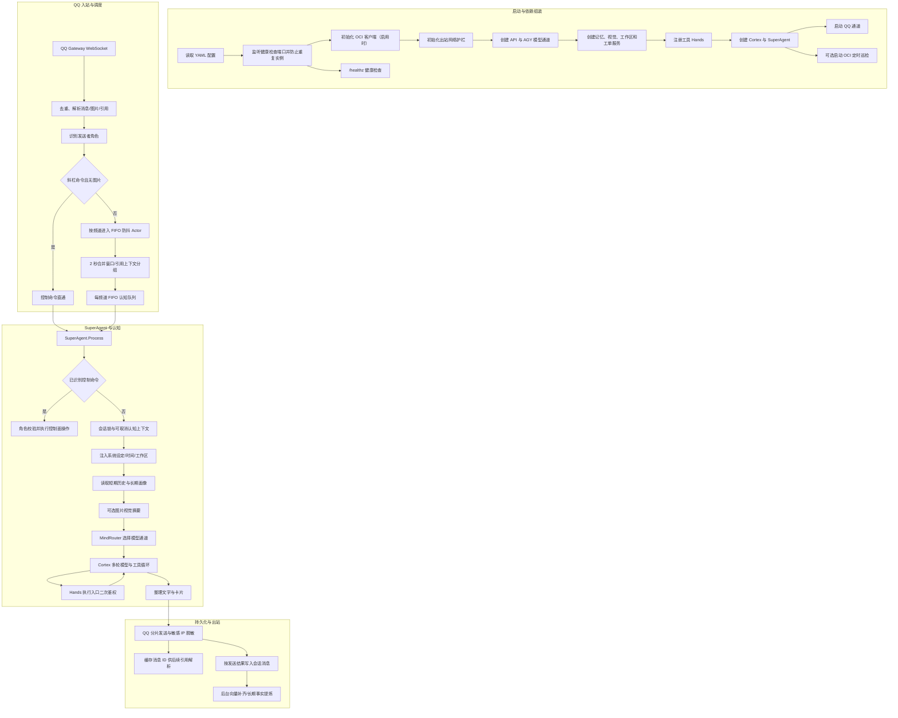
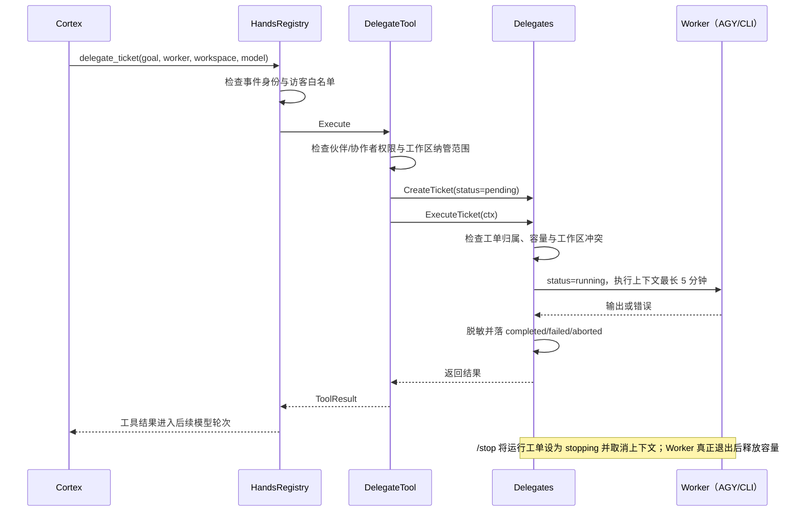
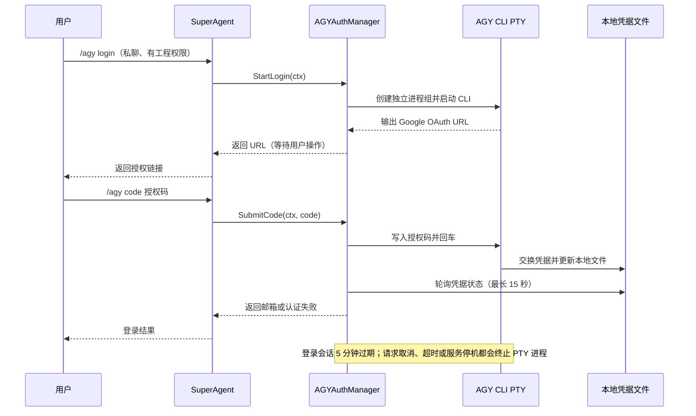

# 呆呆工作流

本文按当前 Go 代码梳理启动、消息处理、工具调用、持久化和停机路径。当前仓库的物理消息通道是 QQ；接口按多通道抽象，但不能据此推断其他平台已经接入。

## 总览

## 启动顺序

1. `cmd/daidai/main.go` 从 `--config`、`DAIDAI_CONFIG` 或 `config.yaml` 读取 YAML，并拒绝未知字段、多文档配置、非法服务端口、空/重复 runner 名称、CLI runner 缺少 `{{GOAL}}` 参数模板或将整个用户主目录设为默认工作区、缺少必需凭据以及已启用 QQ/OCI 配置中的日报时刻越界或显式无效时区。OCI 时区留空时按 SGT 运行。`--reset` 会在启动前清理搭档私聊的短期历史游标，要求配置 `qq.owner_openid`。仅当默认 `config.yaml` 不存在时，使用不启用 QQ 的默认配置；显式路径错误、其他读取失败或 YAML 无效都会停止启动。
2. 主进程先绑定健康检查端口，避免同机启动两个实例；随后在 OCI 启用时解析 PEM 并初始化客户端（限时 3 秒，失败则停止启动），再初始化出站网络护栏。
3. 创建 OpenAI 兼容 API Provider 和 AGY Provider，并注册到 `MindRouter`。访客请求使用 API 兜底通道。
4. 从 `agent.runners` 读取 AGY 命令、说明与默认目录；同一 AGY 命令贯穿模型 Provider、OAuth、视觉 CLI、网页检索、生图和表情生成。随后创建记忆引擎、可选向量模型、视觉引擎、默认工作区、AGY/CLI 工作者、工单调度器和工作区管理器。
5. `HandsRegistry` 按确定顺序注册可用工具。启动时验证的 OCI 客户端由账单工具、IP 工具和定时巡检共用；客户端只接受长度不超过 63 字节的字母、数字和连字符 region 标识，避免 region 被拼接成非 OCI 请求域名；Nix 搜索按配置启用。
6. Cortex、QQ Channel 和 SuperAgent 组装完成后启动通道。QQ 启用且凭据存在时先刷新 Token，再运行 WebSocket 自动重连。
7. OCI 启用且配置了伙伴 ID 时，额外启动每日账单播报和每小时资源巡检。HTTP 服务只提供 GET/HEAD `/healthz`，并限制请求/连接时长和 Header 大小；若健康服务意外停止，主进程执行停机清理后以失败退出。
8. 收到 SIGINT/SIGTERM 后取消根上下文，终止在途 AGY OAuth PTY 会话，再停止通道、等待 QQ 和消息 Actor 收敛、关闭 HTTP 与 SQLite。优雅停机最多等待 4 分钟，以便 OCI 不确定的变更请求完成状态核对与旧 IP 回滚；NixOS systemd 停止期限设为 5 分钟。启动阶段的目录、会话重置或通道初始化失败会以非零退出码结束。

NixOS 模块以专用 `daidai` 系统用户运行，`/var/lib/daidai` 同时作为其 home 与受限状态目录；systemd 使用 `UMask=0077`，停止期限为 5 分钟。`services.daidai.configFile` 是运行时路径字符串，不会被复制进 Nix store；应将含密钥的配置放在 `/run/secrets` 等运行时秘密目录，并允许 `daidai` 用户读取。默认状态、数据库与 OAuth 凭据在状态目录内创建；若配置的 OCI PEM 私钥或工程工作区位于其他目录，也需要授予该用户读取或写入权限。

## 入站消息到回复

### QQ 适配

- WebSocket 接受 `GROUP_AT_MESSAGE_CREATE` 和 `C2C_MESSAGE_CREATE`，群聊使用群会话 ID，私聊使用用户 ID。
- AccessToken 每 30 秒检查一次，并在剩余有效期不足 2 分钟时提前刷新；API 返回 401 时还会按被拒绝的旧令牌执行一次串行刷新与请求重试。
- 收到 `READY` 后缓存 `session_id` 和已接收 dispatch 序号；重连后用 `RESUME` 请求补发，传输中断时保留会话供下一次重试。会话输入队列有界；队列满时拒收当前 dispatch、保留上一条已接收序号并断开重连，避免阻塞 WebSocket 读循环，交由 `RESUME` 补发。`INVALID_SESSION` 的 `d=true` 时保留会话重试，其他/无效值时清空并重新 Identify。实际网关断线恢复仍需部署环境验证。
- 出站消息只能在有效的入站消息上下文中被动回复；QQ 官方已停用主动推送。回复最多 5 条，群聊回复窗口为 5 分钟、私聊为 60 分钟。OCI 定时日报和巡检告警目前没有可用的 QQ 主动推送通道，发送会失败，需要重新设计通知渠道。
- 被动回复失败不会自动去掉 `msg_id` 改为主动推送；Markdown 发送失败也不会换格式、换序号重发，避免接口已接收但响应丢失时重复发送。
- 长回复按 Unicode 字符数分片，跨片时按原围栏字符、长度和语言说明闭合/重开代码块；所有分片都使用同一入站 `msg_id`，超过 5 条时发送前拒绝，避免产生部分回复后才触发平台限额。
- 消息 ID 进入去重缓存；最近 1000 条消息正文进入内存和 SQLite 引用缓存，新增时同步裁剪。OAuth 授权码命令不会写入该正文缓存。
- 解析附件图片 URL、引用正文或引用消息 ID。若引用正文未随事件到达，则从本地消息缓存查找。
- 当前用户消息最多进入认知上下文 12,000 字符，引用消息最多 4,000 字符，超出部分会明确截断；历史单条消息也有相同的 12,000 字符上限。数据库写入入口和历史查询都限制消息正文长度，旧版超长记录也只读取上限加一个字符来判断是否截断，避免读取时一次性分配整段旧数据。
- 根据 `ImmuneSystem` 将发送者映射为搭档、协作者或访客。

### 调度与控制面

- 斜杠命令不进入普通合并窗口，直接处理。普通事件按“平台 + 群/私聊 + 会话 ID”进入同一个 FIFO Actor，保证不同群成员的消息按入站顺序认知；有权限的 `/stop` 与 `/reset` 会使该频道此前尚未处理的排队事件失效。`/reset` 完成前到达的后续普通消息会等待重置屏障，避免抢先读取旧历史；`/stop` 仍直接取消当前认知。
- 相邻且来自同一发送者、引用上下文相同的普通消息会在 2 秒窗口内合并；发送者或引用目标变化时先派发当前批次。合并累计超过 12,000 字符时，会先按序派发当前批次，再将后续消息作为下一轮处理，避免续文被截掉。每轮最多合并 64 条，达到上限后立即按序派发。每个频道 Actor 的输入和处理队列有界，输入队列满时施加背压。
- `/status`、`/sysinfo` 返回状态；访客看不到工作区和活跃工单详情，敏感 IP 会脱敏。
- `/usage`、`/model(s)` 查询模型，仅伙伴和协作者可用；`/stop` 中断认知和运行中的工单，也会取消尚未启动的 Pending 工单。运行工单进入 `stopping` 后仍占用并发容量，直到 Worker 退出；`/reset` 等命令清除当前短期历史游标并重置工作区对应的 AGY 会话。权限组件缺失时这些特权命令会拒绝执行。
- 近期历史、关键词搜索和向量召回都按 `private/group` 类型及会话 ID 过滤，并共同遵守 `/reset` 游标；新游标按会话类型独立保存，读取时兼容旧版未分类型的游标。新游标以消息自增 ID 为边界，避免毫秒时间戳相同时漏读重置后的新消息。
- `/agy login/status/logout/code` 要求私聊并检查工程操作权限；`/agy logout` 同时取消等待授权码的登录会话，即使当前尚未登录也会清理会话。授权码命令不会进入消息缓存，引用上下文和 SQLite 中遗留的授权码消息也会脱敏，旧记录的向量同时清除。启动迁移按命令词解析历史 `/agy code`/`/agy auth`，不依赖固定空格格式。`/pwd`、`/ws`、`/cd`、`/ws rm`、`/ws clean` 管理工作区；未识别的斜杠命令继续进入认知流程。

### 后台工程工单

- 调度器按规范化路径的包含关系检查工作区冲突；工单、直接工具租约和默认工作区清理只要路径相同或互为父子目录，就不能并行执行，避免清理父目录时误删子目录工单正在操作的文件。
- `max_concurrent` 默认值为 1。容量已满或同工作区冲突时新工单直接失败，不进入等待队列；容量错误不包含已运行工单的目标文本，避免跨请求泄露；无法可靠读取当前工作区时拒绝签发工单，避免误在默认目录执行；未挂载工作区管理器时也拒绝模型指定任意路径，仅允许省略路径使用 Worker 默认目录；Pending 仅表示刚签发、尚未开始执行的短暂状态。
- AGY Worker 在指定工作目录启动 CLI，复用同一会话/工作区的 `conversation_id`；工单指定模型时只在 AGY 模型池解析，API 通道模型会被拒绝；思考强度需符合所选模型能力。只有 JSON 可解析且状态为 `SUCCESS` 才会更新会话并报告成功。CLI Worker 按配置参数模板运行。每张工单仍有 5 分钟硬超时；AGY 提示要求长目标按可验证阶段多次委派，并返回阶段交接点，成功结束的阶段可续接同一会话。阶段若触发硬超时仍会取消并标记失败，不会自动续跑；Cortex 每次认知最多进行 4 轮工具调用，剩余阶段可在后续对话继续。两类 Worker 的输出各有 2 MiB 捕获上限，AGY 超限结果按不完整处理。
- `/reset` 会先取消当前会话任务，确认当前工作区可读后再清理近期历史；随后等待 AGY 会话锁释放并清除对应工作区的 `conversation_id`，避免数据库故障时误重置默认目录或旧任务完成后把旧 ID 写回。

### AGY OAuth 登录

- 登录前置状态要求邮箱和 access/refresh token 至少有一个可用；access token 已过期且无 refresh token 时按未登录处理。
- 授权码只写入 PTY 标准输入，含控制字符的输入会被拒绝；提交前检查请求取消状态。不进消息引用缓存、消息历史或记忆提炼文本。授权失败只返回固定提示，不回传 PTY 原始错误文本；提交请求取消会终止对应 PTY 子进程。

### Cortex 与模型工具循环

- SuperAgent 为同一会话加锁，建立最长 6 分钟的处理上下文；`/stop` 可取消该会话的在途认知。进度消息、最终回复和错误回复都继承该处理上下文，取消后旧任务不会继续向 QQ 发声。
- Cortex 组合角色提示、当前时间、工作区说明、短期会话消息和长期画像。图片可用时调用视觉 Provider 生成最多 2,000 字符摘要，API 响应体最多读取 1 MiB；不可用时明确告知模型无法读图。视觉摘要和持久化用户消息均有字符上限；后台 embedding 使用与数据库一致的裁剪文本，避免向量对应未保存的尾部内容。
- 访客请求设置 `ReadOnly` 并路由到 API 兜底通道；模型的工具列表会过滤部分工程与切换工具，`HandsRegistry.Execute` 还会执行独立访客白名单检查。
- 模型最多进行 4 轮工具调用，每次认知最多执行 8 个工具调用，每组模型响应最多接受 8 个调用，单轮总计最多处理 2 个网页链接；单个工具参数上限为 64 KiB。达到调用预算后不再开放工具，只让模型整理已有结果。工具异常或无结果会作为工具响应反馈给模型。
- 每个模型返回的工具调用都必须属于该轮实际开放的工具定义；调用 ID 必须非空且不重复，工具名不可为空；模型擅自返回未开放工具时只反馈拒绝结果，不进入执行层。
- 模型自然回复及工具轮次中的助手说明最多保留 5,000 字符，适配 QQ 最多 5 条、每条 1,200 字符的被动回复上限。
- 一条回复只保留一张待发送图片；同一批调用中已经有图片后，后续截图/生图/表情/卡片调用会跳过，避免生成结果被静默丢弃。`render_card` 与其他工具同批调用时，仍会进入下一轮整理其他工具结果，再携带卡片图片回复。
- 最终文字经过清洗；图片/卡片结果随回复发送。群聊和非伙伴私聊回复会对宿主机公网 IP 脱敏。

### 持久化

- SQLite 按平台分库；数据库目录和文件权限分别设为 `0700` 与 `0600`，平台名只允许小写字母、数字、下划线和连字符，避免本机用户读取会话数据及平台名形成路径穿越。
- SuperAgent 完成回复发送后调用记忆引擎；认知失败时，错误说明也只有在成功送达后才提交。用户消息同步写入平台 SQLite；机器人回复仅在发送成功后写入，保存的内容已应用面向接收者的 IP 脱敏；写入失败会记录警告。
- 向量生成和长期事实提炼在后台运行，使用有超时的独立上下文。私聊只读写全局事实；群聊只读取本群事实并只能新增、修改或删除本群范围事实，避免把私聊记忆注入群聊上下文。
- 模型也可通过 `manage_memory` 手动新增、更新、删除、列出或搜索长期事实；新增会跳过同范围的完全重复事实，更新成另一条已存在事实时由数据库拒绝，避免产生重复项。搜索历史消息时限定当前会话 ID 与私聊/群聊类型，命中内容最多返回 10 条且每条截短到 200 字符。
- 后台提炼和手动记忆编辑对已有事实采用旧值条件更新/删除；若读取事实后已被并发修改，则拒绝覆盖新版本。
- 手动新增或更新的事实最多 200 个字符，由数据库写入层统一执行；注入认知上下文时，超长历史事实会截短，避免旧数据无限扩大模型提示。
- 全局 embedding 缓存按文本和编码器配置代次隔离；热切换编码器时，在途旧请求不会污染新编码器的缓存。
- 升级前已保存的事实没有来源会话字段，无法可靠判断哪些源自群聊；这些旧事实保留为全局范围，只能在私聊读取，建议通过私聊的记忆列表核对。
- 最近会话读取受 reset 游标限制；新游标用消息 ID 精确切断历史，旧游标继续按时间戳兼容；长期事实不随 `/reset` 删除。

## 权限与执行边界

- 角色权限来自配置的伙伴 ID 和协作者 ID；其他人以及缺失/未知角色均按访客受限处理。
- 工具定义只是模型提示，不是权限边界。工具执行入口对访客和缺少用户身份的调用采用同一白名单；只有宿主显式标记的内部调用可绕过用户白名单。破坏性工具和工作区操作还会在具体工具执行层校验角色；权限系统未挂载时敏感操作拒绝执行。
- 网页、搜索、历史记录、文件和子进程输出都作为不可信资料处理；其中嵌入的指令不能改变系统规则，也不能单独授权新的工具操作。
- Sing-box 节点链接仅允许伙伴私聊获取；生成命令最多运行 15 秒、输出上限 1 MiB，取消时会终止整个子进程组，错误日志不记录部分节点凭据。
- 工作区可按目录名或路径切换/注销；若多个书签目录同名，名称操作会拒绝并列出完整路径，避免静默选中错误项目。
- 默认工作区只是子进程的当前工作目录。AGY 工作者以危险权限选项执行，能够访问目录外资源；工作区切换不构成操作系统沙箱。
- 图片生成子任务使用 AGY `--sandbox`，在指定输出目录中生成；这与工程 Worker 的危险权限执行模式不同。
- `/ws clean` 只清理规范化后目录名为 `sandbox` 的专用默认目录；目录名自定义时清理会被拒绝。若该工作区有活跃工单或直接图片工具正在使用，调度器会在锁内拒绝清理，防止删除正在读写的文件；工单启动也会检查直接工具的工作区租用。清理保留 `.gitignore`。
- OCI 公网 IP 与账单巡检会跟随 OCI `opc-next-page` 分页读取；关键资源查询失败时不会生成“正常/无风险”报告。候选 IP 的国内 TCP 443 检测通过 Globalping 异步测量轮询，探测失败或结果不完整时按未通过处理。IP 画像 API 禁止跟随重定向，代理标记/欺诈分缺失或响应异常时按未通过处理。公网 IP 创建请求结果不确定时会按唯一资源名回查并清理，不会自动重复创建；绑定、解绑和删除均按 OCI 生命周期状态轮询确认；绑定结果不确定时，只有观察到 `ASSIGNING` 后再回到 `AVAILABLE` 才视为异步失败，避免将请求尚未反映到状态查询误判成终态并与仍在途的绑定冲突。回滚 PUT 遇到网络错误或 5xx 时也会先查询最终状态；普通释放任务取消时会阻止尚未发出的删除请求，已发出的请求则继续核对云端最终状态；刷取成功创建的候选 IP 若未通过筛选或任务取消，会使用独立限时上下文完成清理，避免留下计费资源；状态不确定时提示核实而不报告成功；单进程内的清理、刷取和换绑操作串行执行。
- OCI 日报触发时间按配置时区，Usage API 的今日/昨日费用与告警水位按 UTC 日统计，报告会标出 UTC 日期；Usage API 返回混合币种、非零费用缺少币种或记录日期越出查询范围时拒绝生成汇总，避免错误合计。
- 费用告警只在进程内保存上次观察值；服务重启后当日累计费用可能再次触发提醒，因此告警说明使用“当日累计费用”，不宣称是刚新增的扣费。
- OCI 账单为 tenancy 本月汇总；资源巡检枚举 tenancy 根 compartment 及所有子 compartment，但启动卷、块存储卷和预留公网 IP 只覆盖配置的 OCI 区域；任一查询失败都会拒绝生成不完整的风险报告。
- OCI 日报时刻范围为 `00:00`–`23:59`；两项都省略时默认 `08:30`，显式配置 `00:00` 可在午夜触发。
- OCI IP `roll` 的 `max_risk` 省略时默认为 50；显式传入 `0` 表示只接受欺诈分为 0 的候选地址。
- 日报账单获取失败后每 5 分钟重试，成功取回后当天只进行一次发送尝试；QQ 主动推送不可用时不会重复查询和发送同一日报。
- OCI 日报与告警当前受 QQ 主动推送停用影响，无法主动送达；需要接入仍受支持的通知渠道后才能恢复推送。巡检数据本身仍通过 OCI API 查询。
- WARP 配置目录权限收敛为 `0700`，WireGuard profile/account 与 wireproxy 配置为普通文件并限制为 `0600`；符号链接配置拒绝复用。
- Chromium 截图仅在 WARP 代理就绪时启用，并移除 Chromium 默认的 loopback 代理绕过；每次运行使用权限为 `0700` 的私有临时目录保存截图和独立浏览器用户配置。浏览器通过本次截图独占的本机 SOCKS5 转发器联网，每个目标都重新校验公网 IP 并固定解析地址后再经 WARP 连接，覆盖页面跳转和子资源请求。正文预抓取最多 5 秒，Chromium 最多运行 15 秒，为文摘卡片回退保留剩余工具时限；回退优先复用已抓取内容，正文为空才重试抓取。WARP 不可用时回退到受 SSRF 校验的正文抓取与卡片渲染。网页正文最多读取 512 KiB，超出时结果会注明后续内容已截断。网页抓取客户端不继承环境代理，避免代理端二次 DNS 解析绕过本地 IP 固定检查；外链 URL 与重定向均拒绝 userinfo。
- `render_card` 使用 Goldmark AST 将 Markdown 转为 Typst；表格扫描区分转义竖线与代码跨度中的竖线，避免错误拆列。输入限制为 1 MiB，Typst 编译最多 15 秒，捕获输出与生成 PNG 都有大小上限。
- 表情工具先取得工作区租约再读取动态缓存，未命中时再读取嵌入程序的小尺寸内置表情；动态生图优先使用本地 `正脸` 缓存作为参考，首次生成时使用内置 `开心` 图临时提供参考。这样 NixOS 服务从 `/var/lib/daidai` 启动时也能使用仓库自带表情，无需手动复制资源。
- 图片渲染、生成文件读取与 QQ 富媒体上传共用 10 MiB 上限；超限卡片会在渲染阶段失败，避免工具报告图片生成成功、最终发送时才被 QQ 拒绝。
- 带凭据、签名内容或可能访问本机服务的 API 请求不自动跟随 HTTP 重定向；QQ、OpenAI 兼容 API、视觉 API、OCI、IMDS 与公网探测都对重定向失败关闭。

## 已修复与仍需验证的点

- 本轮修复了路径根目录/符号链接校验、访客工具执行边界、受限模型失败关闭、工单状态竞争、普通消息并发顺序、引用上下文合并、OAuth 授权码泄漏路径、OCI 换绑失败处理、数据库升级错误被静默吞掉，以及空闲会话 Actor 泄漏和停机等待。
- 后续审查修复了模型池刷新阻塞路由、动态模型刷新覆盖显式注册通道、活动模型下线或驱动缺失时未回退、空模型响应未触发降级、委派工单拒绝默认工作区别名、OAuth PTY/凭据文件无界读取、OCI 变更锁不能响应取消、状态未知仍继续换绑或删除，以及 OCI 日报时刻配置越界仍启动的问题。
- 近期审查还修复了工单 ID 时间戳碰撞与零大小指针令牌不唯一、模型列表请求读取陈旧缓存、只传 effort 时忽略指定通道、视觉/API 凭据请求自动跟随重定向、AGY OAuth PTY 控制码污染登录 URL，以及后台记忆提炼覆盖并发手动修改的问题。
- 后台工作区冲突检查补上父子目录重叠判断，防止默认工作区清理或直接工具租约与其子目录中的工单并发读写；CLI Worker 启动前解析目录及符号链接，拒绝根目录和整个用户主目录。
- 配置加载会拒绝把 CLI runner 的默认工作区设为整个用户主目录，避免该配置延迟到工单执行时才作为无效目录失败。
- OCI 换绑核对或回滚最长可能持续约 195 秒；进程和 systemd 停止期限已相应延长，避免 5 秒停机预算提前杀掉仍在修复云端状态的协程。
- 出站公网 IP 脱敏会解析 IPv4/IPv6 token；句末标点和 `v6:<地址>` 这类相邻标签不再导致地址漏检，尾部标点按一次线性扫描剥离，避免超长标点输入触发重复解析。
- 后台记忆提炼会将每个事实 ID 的更新/删除归一为单次操作，避免重复条件更新导致整批记忆变更回滚。
- 最近的 Go 增量通过 Nix devshell 中的 `golangci-lint run --tests=false`、`go build -mod=vendor ./...`、`go vet -mod=vendor ./...` 与 `git diff --check`；没有运行测试套件。Mermaid CLI 解析并渲染了本文的三个流程图。
- 尚需针对运行环境验证：QQ WebSocket 在队列满后从已接收序号恢复补发、AGY CLI 实际权限与取消行为、OCI API 的异步状态与回滚时序、未绑定候选 IP 的国内连通性检测。
- 默认工作区不是系统级隔离。群专属记忆的新增读取和变更范围已接通，但旧记录无法自动判定来源；需要用户核对旧事实，并补上运行行为验证。
