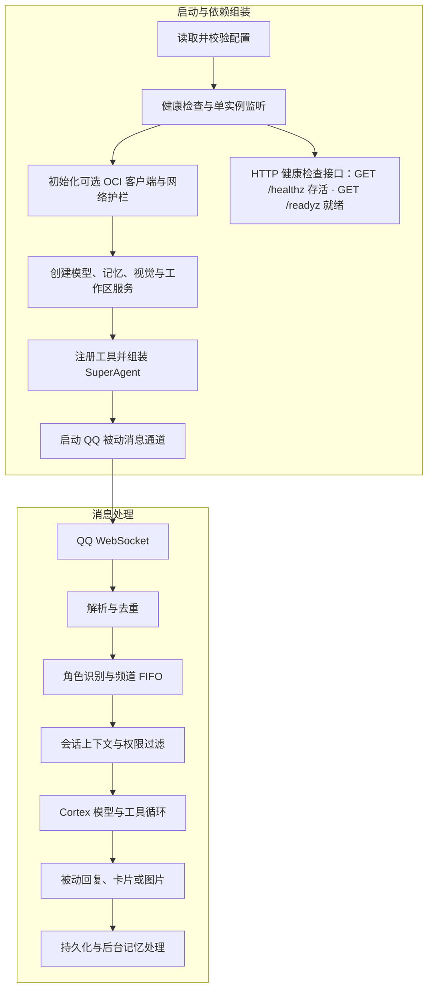

# 呆呆工作流

本文按当前 Go 代码梳理启动、消息处理、工具调用、持久化和停机路径。当前仓库的物理消息通道是 QQ；接口按多通道抽象，但不能据此推断其他平台已经接入。

## 总览

## 阅读路线

- [启动、消息与控制命令](workflow/runtime.md)：进程生命周期、QQ 收发、频道排队与斜杠命令。
- [后台工单与 AGY 登录](workflow/agents.md)：可配置的工单执行时限、并发控制、取消和 OAuth 生命周期。
- [认知、模型与记忆](workflow/cognition.md)：模型工具循环、回复、持久化和记忆范围。
- [权限、工具与运行环境](workflow/security-operations.md)：安全边界、OCI、网页抓取、图片渲染和待验证事项。

## 当前设计约束

- OCI 启用且 QQ 与搭档 OpenID 已配置时，会通过 QQ C2C 主动消息发送每日账单、每小时费用检查和每 6 小时资源巡检告警；资源巡检遍历租户的 compartment，卷与预留公网 IP 检查受配置 region 限制。群聊主动插话由发送层显式区分，并受平台权限策略约束。
- AGY 工程 Worker 使用 CLI Auto 模式和终端沙箱。工单会立即进入后台队列，等待容量时不占用对话请求时限；每张工单默认最长执行 30 分钟，可由 `agent.execution_timeout` 配置。任务结束会主动通知并提供分页查询编号；重启时未完成工单标记为中断，不自动重跑。长任务应拆成可验证阶段，超时后可根据保留输出明确续接。
- 终端沙箱限制 AGY 子命令的文件和网络访问；需要沙箱外权限的操作可能被拒绝或自动审核。机器人进程仍以宿主服务账户运行，CLI 沙箱不等于整个进程的操作系统隔离。
- 群聊长期记忆是“当前用户在本群的个人事实”，不会向同群其他成员共享。
