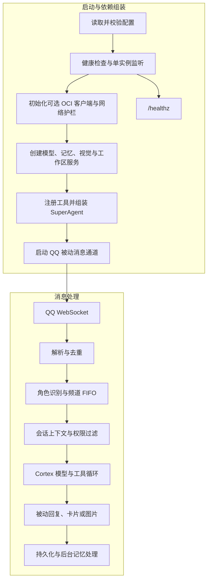

# 呆呆工作流

本文按当前 Go 代码梳理启动、消息处理、工具调用、持久化和停机路径。当前仓库的物理消息通道是 QQ；接口按多通道抽象，但不能据此推断其他平台已经接入。

## 总览

## 阅读路线

- [启动、消息与控制命令](workflow/runtime.md)：进程生命周期、QQ 收发、频道排队与斜杠命令。
- [后台工单与 AGY 登录](workflow/agents.md)：五分钟阶段执行、并发控制、取消和 OAuth 生命周期。
- [认知、模型与记忆](workflow/cognition.md)：模型工具循环、回复、持久化和记忆范围。
- [权限、工具与运行环境](workflow/security-operations.md)：安全边界、OCI、网页抓取、图片渲染和待验证事项。

## 当前设计约束

- QQ 只支持带有效入站上下文的被动回复，因此 OCI 自动日报和巡检通知没有启动；OCI 查询和变更工具仍可按需使用。
- AGY 工程 Worker 的五分钟限制是单阶段上限。长任务应拆成可验证阶段；阶段超时会被取消，不会自动续跑。
- 默认工作区只是工作目录，不是操作系统沙箱。AGY Worker 使用跳过权限确认的模式，进程账户能访问的资源都可能被访问。
- 群聊长期记忆是“当前用户在本群的个人事实”，不会向同群其他成员共享。
