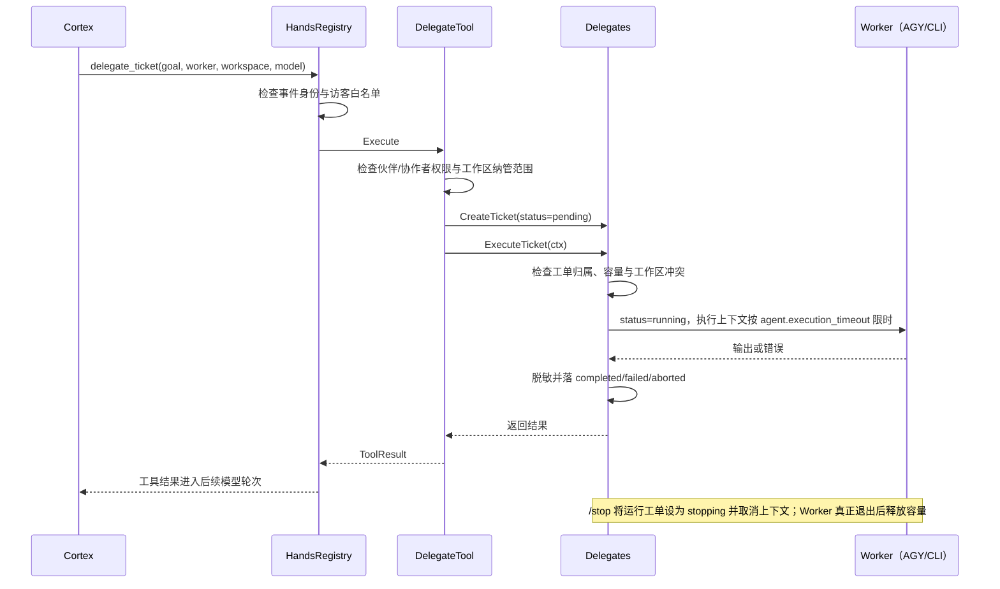
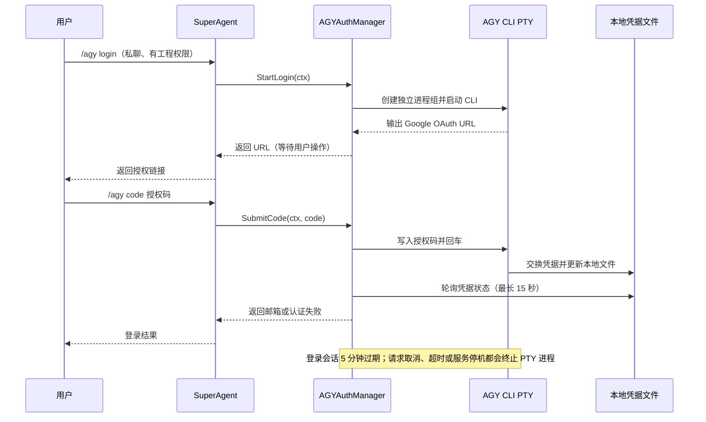

# 后台工单与 AGY 登录

## 工单执行

- 调度器按规范化路径的包含关系检查工作区冲突；工单、直接工具租约和默认工作区清理只要路径相同或互为父子目录，就不能并行执行，避免清理父目录时误删子目录工单正在操作的文件。
- `max_concurrent` 默认值为 1。容量已满或同工作区冲突时新工单直接失败，不进入等待队列；容量错误不包含已运行工单的目标文本，避免跨请求泄露；无法可靠读取当前工作区时拒绝签发工单，避免误在默认目录执行；未挂载工作区管理器时也拒绝模型指定任意路径，仅允许省略路径使用 Worker 默认目录；Pending 仅表示刚签发、尚未开始执行的短暂状态。
- AGY Worker 在指定工作目录启动 CLI，并复用同一发起人、同一会话、同一工作区的 `conversation_id`；该 ID 持久化在平台 SQLite，服务重启后可续接，群内不同成员的上下文相互隔离。群级 `/reset` 会清除该工作区下全部发起人的 AGY 会话。工单指定模型时只在 AGY 模型池中解析；API 通道模型会被拒绝，思考强度也必须符合所选模型能力。CLI Worker 使用配置中的参数模板。
- AGY 只有在输出为可解析 JSON 且状态为 `SUCCESS` 时才报告成功；若非成功结果仍包含有效 `conversation_id`，会保存该 ID 供后续阶段续接。两类 Worker 的输出捕获上限都是 2 MiB；AGY 输出超限按不完整结果处理。
- `agent.execution_timeout` 控制单张工单最长执行时间，默认 30 分钟；设为 `0` 可关闭调度器硬超时，但 `/stop` 和服务停机仍可取消任务。达到配置超时会取消并标记失败，不会自动续跑；若子进程已有输出，会附上截断且明确标注为未完成的部分输出，便于后续阶段继续。若失败输出中仍包含有效会话 ID，也会保存供下一阶段续接。Cortex 每次认知最多进行 4 轮工具调用，剩余阶段可在后续对话继续。
- 工单状态和完整工作者输出持久化在平台 SQLite 中；传回主模型的结果最多 6000 字，超出时会指向 `/task <ID> [页码]` 查询完整输出。进程重启后，未完成工单标记为 `interrupted`，不自动重跑，以免重复外部副作用；通过 `/tasks` 查看当前会话最近 10 张工单，所有活跃工单即使更早创建也会保留在列表中。查询按发起人及会话双重过滤。
- `/reset` 会先取消当前会话任务，确认当前工作区可读后再清理近期历史；随后等待 AGY 会话锁释放并清除对应工作区的 `conversation_id`，避免数据库故障时误重置默认目录或旧任务完成后把旧 ID 写回。

## AGY OAuth 登录

- 登录前置状态要求邮箱和 access/refresh token 至少有一个可用；access token 已过期且无 refresh token 时按未登录处理。
- 授权码只写入 PTY 标准输入，含控制字符的输入会被拒绝；提交前检查请求取消状态。不进消息引用缓存、消息历史或记忆提炼文本。授权失败只返回固定提示，不回传 PTY 原始错误文本；提交请求取消会终止对应 PTY 子进程。
